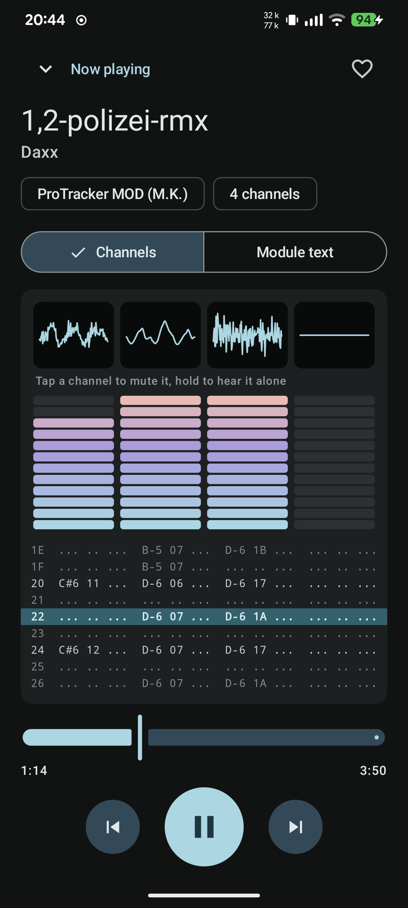
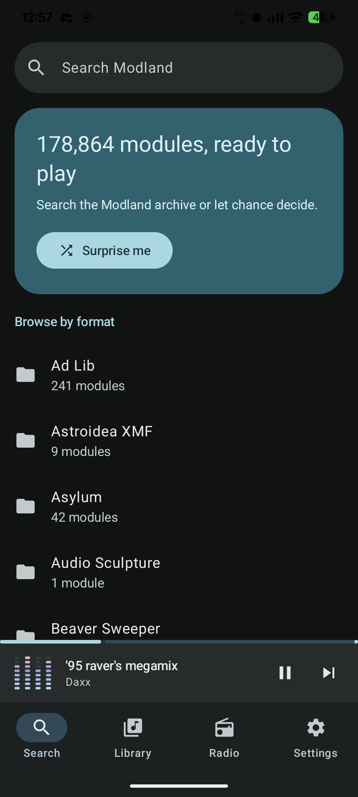
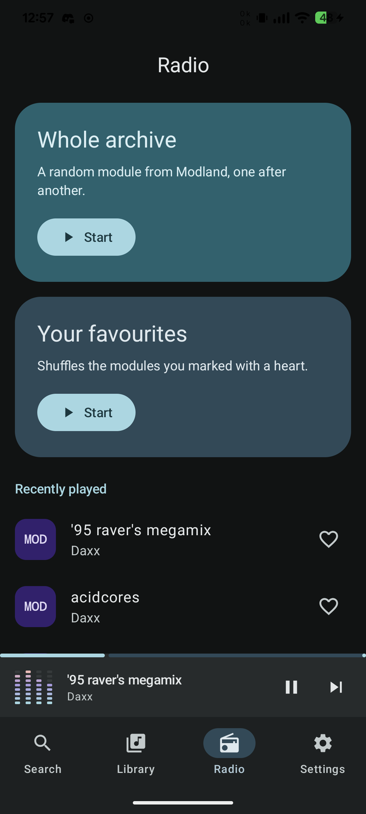

# AMPlatypus (working title)

A free, open-source Android player for Amiga and tracker music – MOD, XM, S3M, IT and some fifty related
formats. It searches the [Modland](https://modland.com) archive (about 179,000 playable modules), downloads
what you pick and plays it with [libopenmpt](https://lib.openmpt.org/libopenmpt/). AHX and HivelyTracker
modules are played by the [HivelyTracker](https://github.com/pete-gordon/hivelytracker) replayer, and exotic
Amiga formats (PreTracker, SidMon, Future Composer, Delta Music and about a hundred more) by
[UADE](https://zakalwe.fi/uade), which runs the original replay routines in an emulated Amiga.

There are two builds. **free** contains only replay routines with a free licence and plays five of the
exotic formats; **full** contains all of them. See [docs/UADE_LICENSING.md](docs/UADE_LICENSING.md).

It is modelled on [4champ](https://github.com/sitomani/4champ), the iOS app by Aleksi Sitomaniemi.
Logic, data model and flow are ported from 4champ; the user interface is rebuilt from scratch
in Kotlin with Jetpack Compose and Material 3.

  
  
  

> **Early test version.** It works day to day on the developer's phone, but expect rough edges.
> The name and the application ID are provisional, and test builds are signed with a debug key, so a later
> proper release will need a fresh install.

## What it does

- **Search and browse** Modland by module name or composer, or by format → composer → module. The archive's
  index is stored on the device, so searching needs no network.
- **Player** with one oscilloscope and one level meter per channel, the pattern scrolling past the play
  position, and the texts musicians left in the module (song message, instrument and sample names).
  Tap a channel's oscilloscope to mute it, hold it to hear that channel alone.
- **Background playback** with notification, lock-screen and headset controls.
- **Library** with favourites, playlists, search and sorting; import of your own module files.
- **Radio**: an endless random pick from the whole archive, or a shuffle of your favourites.
- **Material 3** throughout: dynamic colour on Android 12+, four more colour designs, light and dark,
  English and German.
- No ads, no tracking, no accounts.

## Download

Test builds are attached to the [releases](https://github.com/YoldasKelboW/amplatypus/releases).
Android 8.0 or newer.

Not there yet: muting channels of the UADE formats, formats that need a whole folder of instruments (IFF-SMUS),
an AMP source, tablet layout,
Android Auto. See `CHANGELOG.md` for what changed and `docs/RUNBOOK.md` (German) for the plan.

## Music sources

Sources sit behind one interface (`MusicSource`), so the app does not depend on a single archive.

- **Modland** – the default source, searched through a locally stored index.
- **Local files** – import your own modules through the system file picker.
- **Amiga Music Preservation (AMP)** – not included. It would need an agreement with the AMP staff first
  (see `docs/PERMISSIONS.md`).

## Principles

- No ads, no tracking, no Google Play Services, no Firebase. Only free dependencies from
  Maven Central and Google Maven, so the same build can ship on F-Droid, IzzyOnDroid and Google Play.
- Be gentle with every server: identifying User-Agent, caching, back-off, no bulk downloads.
- Native replayers (libopenmpt, HivelyTracker, UADE) are built from source, never shipped as binaries.

## Building

    git submodule update --init --depth 1
    ./gradlew assembleDebug

See [docs/BUILDING.md](docs/BUILDING.md) for the toolchain and for settings that suit low-memory machines.
CI runs lint, unit tests and the debug build on every push.

## Credits

- [4champ](https://github.com/sitomani/4champ) © Aleksi Sitomaniemi – the app this one is modelled on.
- [Modland](https://modland.com) – the archive maintained by Coma (Daniel Johansson).
- [Amiga Music Preservation](https://amp.dascene.net) – the collection and the people maintaining it.
- This app is developed with the help of an AI coding assistant (Claude Code). See `NOTICE`.

## License

GPL-3.0-or-later, see `LICENSE`. Logic ported from 4champ is used under its MIT option and keeps
the original copyright notice in the file header. See `NOTICE` for third-party components.
